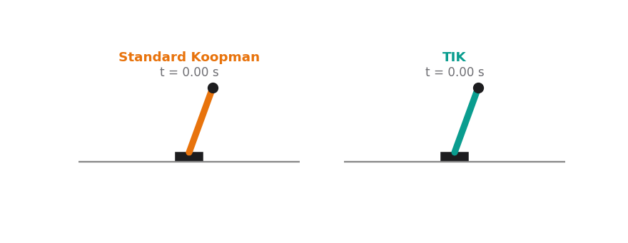

# Tangent-Invariant Koopman (TIK)

[](https://walleclipse.github.io/tik-koopman/)
[](https://walleclipse.github.io/tik-koopman/assets/paper.pdf)
[](https://github.com/Walleclipse/tik-koopman/actions/workflows/ci.yml)
[](LICENSE)


Reference implementation of **Making Koopman Control Guarantees Hold on Robots**  
*Abulikemu Abuduweili and Changliu Liu (Robotics Institute, Carnegie Mellon University)*.

Project Page & Interactive Demos: [**walleclipse.github.io/tik-koopman**](https://walleclipse.github.io/tik-koopman/)  
GitHub Repository: [**github.com/Walleclipse/tik-koopman**](https://github.com/Walleclipse/tik-koopman)

---

<p align="center">
  
</p>

<p align="center">
  <em>Figure: Stabilization on the nonlinear cart-pole from a 20° tilt (half-speed playback). Both models are trained on the same data and certified stable in latent space (&rho; &lt; 1). When deployed with state re-encoding on the true plant, Standard Koopman diverges (&rho;(F) = 10.5) while TIK asymptotically balances upright (&rho;(F) = 0.984).</em>
</p>

---

## Motivation

Koopman operator theory represents a nonlinear dynamical system as a linear model in a higher-dimensional latent space, transforming model predictive control (MPC) into a convex quadratic program (QP). A major benefit is that closed-loop stability can be certified analytically on the learned linear model:

$$\hat{z}_{t+1} = A z_t + B u_t, \quad u_t = -K z_t \implies z_{t+1} = (A - BK) z_t = A_{\mathrm{cl}} z_t$$

When all eigenvalues of $A_{\mathrm{cl}}$ lie inside the unit circle ($\rho(A_{\mathrm{cl}}) < 1$), the controller receives a **nominal stability certificate**.

### The Re-Encoding Discrepancy
On a physical robot, the controller does not evolve on autonomous latent rollouts. Instead, the physical state $x_t$ is measured and re-encoded at every time step through the learned neural encoder:

$$z_t = \Phi_\theta(x_t), \quad u_t = -K \Phi_\theta(x_t), \quad x_{t+1} = f(x_t, u_t)$$

The local stability of the deployed loop on the real system is governed by the physical closed-loop Jacobian:

$$F := \frac{\partial x_{t+1}}{\partial x_t}\Big|_0 = A_f - B_f K J_\theta$$

where $(A_f, B_f)$ are the true plant Jacobians and $J_\theta = \partial\Phi_\theta/\partial x|_0$ is the encoder Jacobian at the target. 

Because standard neural Koopman training supervises state predictions ($C z = x$) over finite horizons, the derivatives of the remaining $N - n_x$ learned observables remain unconstrained at the target. Under real-time re-encoding, these unaligned derivatives corrupt physical feedback: a controller can be nominally certified in latent space ($\rho(A_{\mathrm{cl}}) < 1$) while violently destabilizing the physical plant ($\rho(F) > 1$).

---

## Theoretical Foundation

### 1. Tangent-Space Invariance
Let $E(x, u) = \Phi_\theta(f(x, u)) - A \Phi_\theta(x) - B u$ be the one-step latent prediction error. A model is **tangent-invariant** at the target $(0, 0)$ if the first derivatives of $E$ vanish there:

$$A J_\theta = J_\theta A_f \quad \text{and} \quad B = J_\theta B_f$$

Geometrically, the manifold of valid encodings $\mathcal{M} = \Phi_\theta(\mathbb{R}^{n_x})$ has tangent space $\mathrm{range}(J_\theta)$. Tangent invariance requires the linear latent operator to map tangent vectors identically to the linearized physical plant dynamics.

### 2. Transfer of Stability Certificates (Theorem 2)
When tangent invariance holds, the closed-loop error Jacobian $\mathcal{E} = J_\theta F - A_{\mathrm{cl}} J_\theta = 0$ vanishes for all feedback gains $K$. Consequently:
- Every eigenvalue of the physical Jacobian $F$ is an eigenvalue of $A_{\mathrm{cl}}$.
- Therefore, $\rho(F) \le \rho(A_{\mathrm{cl}})$.
- **Nominal stability ($\rho(A_{\mathrm{cl}}) < 1$) rigorously guarantees local exponential stability on the physical plant.**

### 3. Obstruction of Stable-by-Construction Models (Corollary 3)
At an open-loop unstable equilibrium ($\rho(A_f) > 1$, e.g., balancing tasks), tangent invariance proves that any valid model must satisfy $\rho(A) \ge \rho(A_f) > 1$. Therefore, architectures that constrain $A$ to be open-loop stable by construction ($\rho(A) \le 1$) can **never** be tangent-invariant at an unstable equilibrium.

---

## Method: Tangent-Invariant Koopman (TIK)

TIK builds tangent invariance directly into the latent matrices by construction for any neural encoder $\Phi_\theta$, without requiring numerical simulator derivatives:

1. **Local Plant Linearization:** Estimate $(\hat{A}_f, \hat{B}_f)$ from logged offline transitions near the target via weighted least squares.
2. **Tangent-Invariant Parameterization:** Let $P_\perp = I - J_\theta J_\theta^+$ project onto the orthogonal complement of $\mathrm{range}(J_\theta)$. We parameterize:
   $$A(\theta, W) = J_\theta \hat{A}_f J_\theta^+ + W P_\perp, \quad B(\theta) = J_\theta \hat{B}_f$$
   This guarantees $A J_\theta = J_\theta \hat{A}_f$ and $B = J_\theta \hat{B}_f$ identically for any unconstrained parameter $W \in \mathbb{R}^{N \times N}$ and any encoder parameter $\theta$.
3. **State-Dependent Actuation:** For large maneuvers (e.g., swing-up), an optional bilinear term $\sum_j u_j N_j z$ captures configuration-dependent actuation without affecting the centered local guarantees.
4. **Offline Stability Certification & Invariant Terminal Sets:** Under explicit curvature and measurement noise bounds, TIK computes an analytical error bound $\eta$ and compares it to the real stability radius $r_{\mathbb{R}}(\hat{F})$. If $\eta < r_{\mathbb{R}}(\hat{F})$, plant stability is certified from offline data alone. For constrained dual-mode MPC, TIK constructs a forward-invariant ellipsoid $\Omega_c$.

---

## Key Experimental Highlights

| System | Standard Koopman (Nominally Certified $\to$ Plant-Stable) | Tangent-Invariant Koopman (TIK) |
|---|:---:|:---:|
| **Cart-pole (ODE)** | 0 / 10 | **10 / 10** |
| **Cart-pole (MuJoCo)** | 0 / 10 | **10 / 10** |
| **Double cart-pole (MuJoCo)** | 0 / 10 | **10 / 10** |
| **Double pendulum (Upright)** | 0 / 10 | **10 / 10** |

- **Real-Time Dual-Mode MPC:** Under a tight **0.25 ms/step** planning budget, TIK achieves **88%** swing-up and **99%** recovery, where neural network MPPI cannot execute a single forward pass. All **7,036** rollouts entering $\Omega_c$ converge without constraint violations.
- **Double Cart-Pole Dual-Mode QP-MPC:** TIK dual-mode QP-MPC achieves **83%** success across 20 models (with individual seeds reaching **95%**), while Standard Koopman achieves **0%** ($10/10$ fail).
- **High-DoF Robots:** Solves convex QPs on a 7-DoF Kinova Gen3 manipulator in **2.1 ms** (100% reach at 5 ms), and stabilizes a 35-D Unitree Go2 quadruped under pushes and domain shifts **7.4&times; faster** than neural NMPC.

---

## Installation

Clone the repository and install the package:

```bash
git clone https://github.com/Walleclipse/tik-koopman.git
cd tik-koopman

# Install in editable mode with development dependencies
pip install -e ".[plots,dev]"

# Run unit tests
pytest -q
```

*Note:* If you encounter multi-threaded BLAS conflicts on macOS, run with `OMP_NUM_THREADS=1`.

---

## Quickstart

```python
import tik

# 1. Initialize plant and evaluate ground-truth Jacobians (for evaluation only)
plant = tik.CartPole()
A_f, B_f = plant.linearize()

# 2. Collect offline data over the state space and near the target
data = tik.collect(plant, n_traj=1500, horizon=40)
near = tik.collect(plant, n_traj=300, horizon=20, scale=0.02)

# 3. Fit local linearization from logged data without simulator derivatives
fit = tik.fit_local_linearization(*near.transitions(), radius=1.0)

# 4. Train Standard Koopman and fine-tune with Tangent Invariance
standard = tik.train_standard(tik.KoopmanModel(4, 1), data)
model = tik.finetune_tik(standard, fit, data)

# 5. Check nominal model stability vs. deployed physical stability
ctl = tik.KoopmanLQR.from_model(model)
print(f"Nominal stability certificate rho(A - BK):       {ctl.latent_radius:.4f}")
print(f"Physical deployed rate rho(A_f - B_f K J):       {ctl.deployed_radius(A_f, B_f):.4f}")
```

---

## Standalone Examples

The repository includes three self-contained runnable scripts in [`examples/`](examples/):

1. **`examples/01_scalar_example.py`** (NumPy only):  
   Minimal scalar system demonstrating how a model can fit training data with zero state error, pass the nominal certificate ($\rho(A_{\mathrm{cl}}) = 0.951 < 1$), yet diverge on the plant ($F = 1.078 > 1$). Shows how TIK restores true stability ($F = 0.397 < 1$).

2. **`examples/02_cartpole_standard_vs_tik.py`** (~3 min on laptop CPU):  
   End-to-end training of Standard Koopman vs. TIK on the cart-pole across multiple seeds, comparing nominal stability $\rho(A_{\mathrm{cl}})$, physical stability $\rho(F)$, and tilt recovery.

3. **`examples/03_offline_certificate.py`** (seconds):  
   Demonstrates data-driven stability certification (Theorem 5) and invariant terminal set construction (Theorem 7) purely from logged data without a simulator.

---

## Repository Structure

```
tik-koopman/
├── tik/                  # Core library
│   ├── systems.py        # Dynamical systems & simulators (Cart-Pole)
│   ├── data.py           # Offline trajectory data collection
│   ├── models.py         # Standard Koopman & Tangent-Invariant Koopman (TIK)
│   ├── fit.py            # Local linearization & analytical error bounds
│   ├── certify.py        # Data-driven stability certificates & terminal sets
│   ├── lqr.py            # Discrete-time algebraic Riccati equation (DARE) & LQR
│   ├── control.py        # Closed-loop simulation & rollout evaluation
│   └── train.py          # Training and fine-tuning routines
├── examples/             # Standalone runnable scripts
├── tests/                # Unit tests verifying theoretical identities
├── scripts/              # Visualization & export scripts (make_gif.py)
└── docs/                 # Static project webpage
```

---

## Citation

If you find this work or code useful, please cite:

```bibtex
@article{abuduweili2027tik,
  title   = {Making {Koopman} Control Guarantees Hold on Robots},
  author  = {Abuduweili, Abulikemu and Liu, Changliu},
  journal = {arXiv preprint},
  year    = {2027},
  url     = {https://github.com/Walleclipse/tik-koopman}
}
```

---

## License

This project is licensed under the MIT License - see the [LICENSE](LICENSE) file for details.
