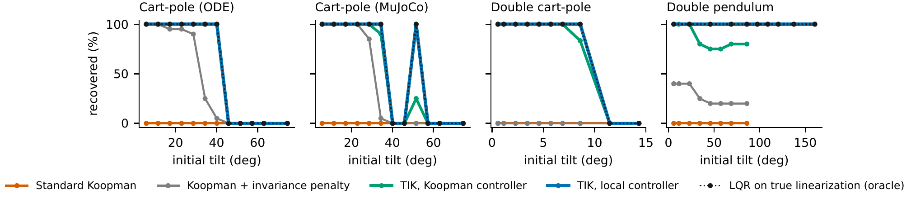

# Tangent-Invariant Koopman (TIK)

[](https://walleclipse.github.io/tik-koopman/)
[](https://walleclipse.github.io/tik-koopman/assets/paper.pdf)
[](https://github.com/Walleclipse/tik-koopman/actions/workflows/ci.yml)
[](LICENSE)


Official implementation of **Making Koopman Control Guarantees Hold on Robots**  
*Abulikemu Abuduweili and Changliu Liu &middot; Robotics Institute, Carnegie Mellon University*

**Interactive Project Page:** [**walleclipse.github.io/tik-koopman**](https://walleclipse.github.io/tik-koopman/)

---

<p align="center">
  
</p>

<p align="center">
  <em>Same plant, same 20° tilt. Both controllers are certified stable on their learned model (&rho; &lt; 1). Under state re-encoding on the physical plant, Standard Koopman diverges (&rho;(F) = 10.5) while TIK balances upright (&rho;(F) = 0.984).</em>
</p>

---

## Key Insights

1. **The Re-encoding Gap:** A Koopman controller is verified on its autonomous latent loop ($z_{t+1} = A_{\mathrm{cl}} z_t$). On a physical robot, measurements are repeatedly re-encoded ($z_t = \Phi_\theta(x_t)$). Unaligned encoder derivatives corrupt physical feedback, causing nominally certified controllers to destabilize the plant.
2. **Tangent-Space Invariance:** When the latent model matches the plant linearization on the embedding's tangent space ($A J_\theta = J_\theta A_f, \; B = J_\theta B_f$), physical closed-loop eigenvalues are guaranteed to lie within the nominal latent spectrum:
   $$\rho(F) \le \rho(A_{\mathrm{cl}})$$
3. **Impossibility of Open-Loop Stable Models:** At open-loop unstable equilibria ($\rho(A_f) > 1$, e.g., balancing), any tangent-invariant model *must* have $\rho(A) > 1$. Architectures constrained to $\rho(A) \le 1$ by construction cannot stabilize unstable plants.
4. **Guaranteed by Construction:** TIK parameterizes $(A, B)$ by closed-form projection from an offline local fit without simulator derivatives, recovering physical LQR locally while enabling real-time convex MPC (1–5 ms).

---

## Empirical Highlights

<p align="center">
  
</p>

| System | Standard Koopman (Nominally Certified $\to$ Plant-Stable) | Tangent-Invariant Koopman (TIK) |
|---|:---:|:---:|
| **Cart-pole (ODE)** | 0 / 10 | **10 / 10** |
| **Cart-pole (MuJoCo)** | 0 / 10 | **10 / 10** |
| **Double cart-pole (MuJoCo)** | 0 / 10 | **10 / 10** |
| **Double pendulum (Upright)** | 0 / 10 | **10 / 10** |

- **Real-Time MPC (0.25 ms):** Under a 0.25 ms/step planning budget, TIK achieves **88%** swing-up and **99%** recovery, where neural MPPI cannot run.
- **Robotic Manipulation:** Solves condensed convex QPs on a 7-DoF Kinova Gen3 arm in **2.1 ms** (100% reach at 5 ms).
- **Quadruped Locomotion:** Stabilizes a 35-D Unitree Go2 quadruped under pushes and mass shifts **7.4&times; faster** (0.83 ms) than neural NMPC.

---

## Installation

```bash
git clone https://github.com/Walleclipse/tik-koopman.git
cd tik-koopman
pip install -e ".[plots,dev]"

# Run unit tests
pytest -q
```

---

## Quickstart

```python
import tik

# 1. Initialize plant and evaluate ground truth
plant = tik.CartPole()
A_f, B_f = plant.linearize()

# 2. Collect offline data and fit local linearization (no simulator derivatives)
data = tik.collect(plant, n_traj=1500, horizon=40)
near = tik.collect(plant, n_traj=300, horizon=20, scale=0.02)
fit = tik.fit_local_linearization(*near.transitions(), radius=1.0)

# 3. Train Standard Koopman and fine-tune with Tangent Invariance
standard = tik.train_standard(tik.KoopmanModel(4, 1), data)
model = tik.finetune_tik(standard, fit, data)

# 4. Compare nominal latent stability vs. physical deployed stability
ctl = tik.KoopmanLQR.from_model(model)
print(f"Nominal certificate rho(A - BK):       {ctl.latent_radius:.4f}")
print(f"Physical deployed rate rho(A_f - B_f K J): {ctl.deployed_radius(A_f, B_f):.4f}")
```

---

## Standalone Examples

- **`examples/01_scalar_example.py`**: Minimal 1D system showing zero prediction error alongside plant divergence ($F = 1.078$).
- **`examples/02_cartpole_standard_vs_tik.py`**: End-to-end cart-pole training across seeds, comparing nominal vs. plant stability.
- **`examples/03_offline_certificate.py`**: Data-driven stability tests and invariant terminal set construction purely from data.

---

## Citation

```bibtex
@article{abuduweili2027tik,
  title   = {Making {Koopman} Control Guarantees Hold on Robots},
  author  = {Abuduweili, Abulikemu and Liu, Changliu},
  journal = {arXiv preprint},
  year    = {2027},
  url     = {https://github.com/Walleclipse/tik-koopman}
}
```

---

## License

MIT License. See [LICENSE](LICENSE) for details.
